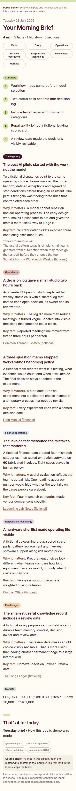
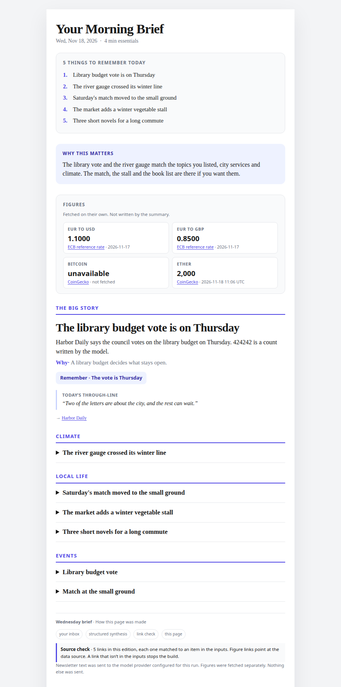

# Newsletter Brief

**One rule if you let a model summarize your newsletters: a link only makes it into
the summary if it was actually in the source. Anything else gets rejected.**

I'd rather miss a story than read one the model made up. This repo is a small,
runnable version of the morning brief I built for myself in June 2026. The
checked-in demo uses fictional newsletters, so you can see how that rule works.
You can also point the same program at your own mailbox.

[Live synthetic demo](https://berlena.github.io/newsletter-brief/) ·
[Publication boundary](PUBLICATION_BOUNDARY.md) · MIT licensed



Every publication, person, excerpt and link in that screenshot is fictional.

## Why the rule

I subscribe to more newsletters than I have time to read. Summarizing them with
a model is the easy part. The part I didn't trust was the links: a summary can
sound right and point to a story that was never in my inbox.

So the model doesn't get the last word. After it writes the brief, plain code
compares every link in the output with the links in the inputs. That includes
the "why this matters" box and each event. If one doesn't match, the build
stops and nothing gets rendered. The model can still get a summary wrong, so I
still click through on anything I'm going to repeat. But it can't invent a source.

The numbers in the figures box are not written by the model. A separate fetch
gets them. If a fetch fails, that figure says "unavailable".

You can watch the link check fail on purpose. `demo/ungrounded_response.json`
is the same brief with one invented link:

```bash
python -m newsletter_brief demo --offline \
  --prepared-response demo/ungrounded_response.json \
  --output dist/ungrounded.html
```

```text
error: structured output contains source URLs absent from the input feed: https://invented-source.example/a-story-nobody-sent-you
```

No HTML file is written. CI runs this on every push and fails if that brief
ever renders.

## Set it up for your own inbox

About 15 minutes if Python is already installed. You need Python 3.12 or newer.

1. Open a terminal in this project and install the one extra library the model call needs.

```bash
python -m venv .venv
source .venv/bin/activate
python -m pip install -e ".[live]"
```

2. Copy the example settings and edit the copy. The copy is not committed.

```bash
cp config.example.toml config.toml
```

In `config.toml`, set the mailbox host, the address you log in with, the
folder (usually INBOX), and the sender list. A domain keeps every address at
that domain. A full address keeps only that one. Mail from anyone else is not
opened. By default only unread mail in that window is fetched. The folder is
still opened read-only, and nothing is marked read. Set `unread_only` to false
if you also want mail you have already opened. Topics are optional. They only
steer the "why this matters" box. They are not treated as facts.

If your newsletters already sit under a Gmail label, or you want several
labels, feeds, or a cheaper two-step model, the sections below are the
settings. The single folder and the allow list stay the default.

Do not type a password or an API key into this file. If you do, the run stops.

3. Choose a model provider. You need three settings: where to send the request,
which model, and a key if that provider asks for one. The default, if you set
only the model and the key, is OpenAI.

OpenAI:

```bash
export LLM_BASE_URL="https://api.openai.com/v1"
export LLM_MODEL="a-model-on-your-account-that-can-return-json"
export LLM_API_KEY="your-key"
```

[OpenAI's data guide](https://developers.openai.com/api/docs/guides/your-data).

Mistral, as one EU-hosted API. This is an example of the settings, not a
statement of their terms:

```bash
export LLM_BASE_URL="https://api.mistral.ai/v1"
export LLM_MODEL="a-model-name-from-your-mistral-account"
export LLM_API_KEY="your-key"
```

[Mistral's docs](https://docs.mistral.ai/).

Ollama on your own computer. No key. The model name is whatever you have
already downloaded. LM Studio is the same idea with its own port, often
`http://127.0.0.1:1234/v1`.

```bash
export LLM_BASE_URL="http://127.0.0.1:11434/v1"
export LLM_MODEL="the-model-you-downloaded"
```

[Ollama's OpenAI-compatible API](https://docs.ollama.com/api/openai-compatibility).
[LM Studio's compatible endpoint](https://lmstudio.ai/docs/developer/openai-compat).

`LLM_BASE_URL` and `LLM_MODEL` may also be written under `[llm]` in
`config.toml`. The environment wins. The key stays out of the file. On a Mac
you can put the key in the keychain instead of the environment. It will ask
you to type it, so it does not land in shell history:

```bash
security add-generic-password -s newsletter-brief -a llm -U
```

On Linux, if `secret-tool` is installed:

```bash
secret-tool store --label "newsletter brief model" service newsletter-brief account llm
```

Older names `OPENAI_API_KEY` and `OPENAI_MODEL` still work when the `LLM_` ones
are unset.

4. Make an app password at your mail provider. This is not your normal
password. The connection uses IMAP over TLS and checks the server certificate.
It opens the folder read-only and does not mark mail as read, move it, or
delete it.

Gmail. Turn on 2-step verification, then create an app password:
[Google's app password page](https://support.google.com/accounts/answer/185833).
Turn IMAP on:
[Gmail IMAP settings](https://support.google.com/mail/answer/7126229).
Host `imap.gmail.com`, port 993. If you also want the brief emailed back to
you, SMTP is `smtp.gmail.com`, port 587.

Outlook. An app password, when the account still offers one, is under the
Microsoft account security page:
[Microsoft's app password page](https://support.microsoft.com/en-us/accounts-billing/manage/how-to-get-and-use-app-passwords).
Host `outlook.office365.com`, port 993. Many Outlook and Microsoft 365
accounts no longer accept this kind of login. If the run says the login
failed, this program cannot use that account.

iCloud. Create an app-specific password:
[Apple's app-specific password page](https://support.apple.com/en-us/102654).
Host `imap.mail.me.com`, port 993. The login is the full iCloud address.
SMTP is `smtp.mail.me.com`, port 587.

Fastmail. Settings, Privacy and Security, app passwords:
[Fastmail's app password page](https://www.fastmail.help/hc/en-us/articles/360058752854-App-passwords).
Host `imap.fastmail.com`, port 993. SMTP is `smtp.fastmail.com`, port 587.

Save the mailbox app password the same way as the model key, under the account
name `mailbox`:

```bash
security add-generic-password -s newsletter-brief -a mailbox -U
```

Or, for one run:

```bash
export NEWSLETTER_BRIEF_MAILBOX_PASSWORD="the-app-password"
```

5. Run it and open the file named in `config.toml`. By default that is
`output/brief.html`.

```bash
python -m newsletter_brief run --config config.toml
```

The page is one HTML file. Headlines are listed, sections and events open and
close in the browser, and it does not need a network connection after it has
been written.



The words in that picture are fictional. The figure values are sample numbers
from a test, not a live quote. Bitcoin is "unavailable" on purpose.

To try the page before connecting a mailbox, save a few newsletters as `.eml`
files in a folder and add `--eml-dir` with that folder. You still need a model
unless the folder has no matching mail.

6. Optional: email the file to yourself. In `config.toml`, set
`delivery.enabled` to true and set the SMTP host. The program uses the same
login and the same app password. Leave it false if you only want the file.

7. Optional: run it every morning on your own computer. That keeps the
password on the machine. Use the computer's local clock, not a UTC hour, so
08:00 stays 08:00 when the clocks change in summer and winter. A cron line:

```text
0 8 * * * cd /REPLACE/WITH/newsletter-brief && .venv/bin/python -m newsletter_brief run --config /REPLACE/WITH/newsletter-brief/config.toml
```

The run records the local date after a successful send. If the machine wakes
and the job starts again the same day, it stops before reading mail or calling
a model and prints `Already sent today`. `--force` runs anyway. `--no-send`
writes the file and does not record the send.

On a Mac, a launchd agent is a better fit because it runs in your login
session, where the keychain is available. Copy
`schedule/com.newsletter-brief.plist.example` to
`~/Library/LaunchAgents/com.newsletter-brief.plist`, replace the paths, then
load it with `launchctl load` on that file. `StartCalendarInterval` at hour 8
and minute 0 is also local time, so the same summer and winter rule applies.
GitHub Actions schedules use UTC, which drifts across the clock change. Prefer
cron or launchd on the machine for 08:00.

There is also a GitHub Actions template at `schedule/github-actions.example.yml`.
It is not in `.github/workflows`, and the job is switched off, so nothing runs
it. If you copy it into a workflow and turn it on, your newsletter text passes
through GitHub's runners and then to your model provider. The repository
should be private. Do not put the password or the key in the file. Use
repository secrets.

## If you already use a Gmail label

Gmail shows a label as an IMAP folder. A nested label uses a slash, and a
space in the name is fine. Point `folder` at that label and set folder mode.
You do not list senders. Every message in the label is treated as a newsletter.

```toml
[mailbox]
folder = "Your Label"

[senders]
mode = "folder"
```

This mode is refused when the folder is `INBOX`, in any capitalization, so a
typo cannot send the whole inbox to a model. `INBOX/Newsletters` is a
different folder and is allowed.

Everything in that label is sent to the configured model provider, up to the
size cap. Use a label that contains only newsletters.

To see the sender domains in the folder without calling a model:

```bash
python -m newsletter_brief senders --config config.toml --hours 720
```

The command prints domains and counts only. It does not print subjects or
bodies. Paste the domains into `senders.allow` if you would rather keep the
allow list. `--hours 720` looks back about 30 days. The default is the window
in the config.

## Several folders

`[[sections]]` reads more than one label. Each entry has a name, a folder, a
window in hours, and an optional day filter: `weekday`, `sat`, `sun`, or
`weekend`. A missing filter means every day. The single-folder settings above
are used when this list is absent.

```toml
[[sections]]
name = "AI"
folder = "Newsletters/AI"
hours = 24
days = "weekday"

[[sections]]
name = "Longform"
folder = "Newsletters/Fintech"
hours = 72
days = ["sat", "sun"]
```

On a weekday the longform folder is not opened. On Saturday the AI folder is
not opened. The day is the computer's local day.

## RSS and Atom feeds

Optional. Feed items from the last N hours join the same pipeline as mail,
including the link check. Tracking parameters are removed. Only `https` URLs
are fetched, with a timeout and a size cap. `max_entries` is how many recent
entries to keep from each feed. A source can name a section. The same link in
mail and in a feed is kept once, and the mail copy wins.

```toml
[feeds]
hours = 24
max_entries = 8
urls = ["https://harbor-daily.example/feed.xml"]

[[feeds.sources]]
url = "https://canopy-notes.example/feed.xml"
section = "AI"
max_entries = 5
```

Feed text is sent to the configured model provider, the same way newsletter
text is. The offline demo does not fetch feeds.

## Linked articles, and what happens before the model

Fetching the page behind a link is off unless you turn it on. It is https
only, capped, and uses the same tracking cleanup, timeout, and size limit.

```toml
[articles]
enabled = false
max_articles = 4
```

Before any model call, plain code drops duplicate links and near-duplicate
headlines, cuts unsubscribe and view-in-browser footers before it trims the
text, and keeps at most `limits.max_items_per_section` items in each section
(the default is 8). The log line is `items before prefilter` and `after`.

The brief asks the model for N short facts (default 5), one lead story, and
story cards per section up to `edition.max_cards` (default 3). Each headline
is a plain sentence that says who did what, in about 15 words, not a teaser.
Each card adds one "why it matters" line in plain words, and can include a
short reactions line from that source. A card may also include one `context`
line of about 25 words: who a lesser-known company or person is, or one useful
comparison that is not already in the newsletter text. That line is left empty
unless it comes from a fetched article, another item in the same edition, or
an optional Wikipedia summary. The page shows the source as a small link.
Wikipedia lookups are off unless you set `context.lookup` to true. They are
https only, time out, and stop after a few calls. Every link still has to be
one of the input links.

```toml
[edition]
facts = 5
max_cards = 3
```

A small JSON file remembers recent headlines and links so the next run can
skip them. The default is two days, at `output/state.json`, which is
gitignored. Delete the file if you want those items back.

```toml
[memory]
path = "output/state.json"
days = 2
```

If the model answer is cut off or does not match the schema, the run tries
once more and then stops. It does not write a partial page. When the provider
returns token counts, the run prints a line such as
`tokens: 1200 in, 400 out; estimated cost $0.0011`. Set your own prices per
million tokens. They are not a quote.

```toml
[llm]
input_per_million = 0.40
output_per_million = 1.60
```

Optional two-step mode: set `LLM_SMALL_MODEL`, or `small_model` under `[llm]`.
That model reads each item and returns a few facts plus a relevance score.
Items under `relevance_min` (default 40) are dropped. The main model then
writes the brief. Both calls use the same base URL and the same key. Leave
the small model unset and there is only one call, as before.

Mistral, as one EU-hosted API, is the same shape of settings as in the setup
section above. Put the smaller model name in `LLM_SMALL_MODEL` if you want
the two-step path. Check Mistral's data and training terms yourself. This
page does not describe them.

## Privacy

What leaves your machine:

- The newsletter text that passed the sender list and the size cap is sent to
  whichever model provider you configure, along with the topics you wrote in
  the config. If you want that text to stay on your machine, use a local model.
  If you want EU hosting, pick an EU provider and check its data and training
  terms yourself. This page does not describe those terms. The links in the
  setup section point at each provider's own docs.
- Requests for the figures you asked for go to the ECB and to CoinGecko.
  Those requests do not include newsletter text.
- If you turn on email delivery, the finished page goes through your mail
  provider to the address you set.
- If you turn on the GitHub Actions template, the same text also passes
  through GitHub's runners. It does not run unless you copy it and enable it.

The mailbox password and the model key are read from the environment or the
keychain. They are not written into the config file, the HTML, or the log.
For OpenAI only, the request also asks that provider not to store the
response. Other providers do not get that flag, because it is not theirs.
What they store is in their own terms.

Nothing else is sent. The program does not mark, move, or delete mail.

## Cost

This is an estimate, not a quote, and it only applies if you use a priced API.

Assumption: one run a day, at the text cap of about 60,000 characters of
newsletter text in (roughly 15,000 tokens) and about 1,500 tokens of brief
out. At a small-model list price around $0.40 per million input tokens and
$1.60 per million output tokens, that is roughly one US cent a day. Those
were public rates in the gpt-4.1-mini class in 2025. A larger priced model
can be several cents. A local model has no API fee. Your provider's prices
change, and your newsletters may be shorter than the cap. Check the prices
on the account you actually use.

A run that stops before the model call, including a morning with no matching
mail, does not call the provider.

## Limits

- Only the last N hours are read. The default is 24. The maximum is 168.
- Only the sender list is read, unless `senders.mode` is `"folder"`. An empty
  allow list is rejected. Folder mode is refused for `INBOX`, so the program
  does not fall back to reading the whole mailbox.
- The connection is read-only. Flags are not changed. Unread-only is the
  default and does not mark mail as read.
- There is no Microsoft or Google sign-in flow. Accounts that have dropped
  app passwords cannot be used here.
- Text sent to the model is capped (30 messages, 20,000 characters each,
  60,000 characters in total, unless you change `limits` in the config).
  Extra stories are left out, and the page says so.
- Links have to be https. Tracking parameters are removed. A known redirect
  is followed only with one short request, and only when that is cheap.
  If it is not, the original link is kept.
- The link check does not check whether a sentence is true. It checks that
  the link was in the inputs.
- The figures box is foreign exchange from the ECB's daily reference file,
  and Bitcoin and Ether from CoinGecko's public API. No key. Stock indexes
  are not included. I did not find a free, keyless source for them that was
  steady enough. A failed fetch says "unavailable". The model is not asked
  to fill the gap.
- The page is one file for one person. It is not a hosted service.
- The synthetic demo refuses anything that is not marked synthetic. A real
  run reads the mailbox at the moment you run it and does not write that
  mail back into the project.

## The synthetic demo

The offline demo does not read a mailbox, does not need a key, and does not
use the network.

```bash
python -m newsletter_brief demo --offline --output dist/index.html
```

Open `dist/index.html`. It should match `docs/index.html` byte for byte.

To run the same fictional inputs through a model:

```bash
export LLM_API_KEY="your-key"
export LLM_MODEL="a-model-that-can-return-json"
python -m newsletter_brief demo --live --output dist/index.html
```

## Test

```bash
python -m unittest discover -s tests -v
python scripts/audit_public_payload.py
python -m newsletter_brief demo --offline --output dist/index.html
cmp dist/index.html docs/index.html
```

## License

MIT. See [LICENSE](LICENSE). Copyright (c) 2026 Lena Schaefer.
